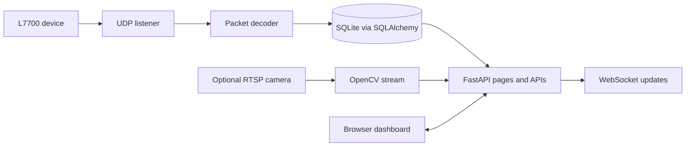

# Nurse Call System

A Python/FastAPI prototype for receiving L7700 device events, storing room and call data in SQLite, and presenting updates through a web interface. The repository also includes optional camera-streaming components.

This is a software project, not a clinically validated or certified system. Do not use it as the sole mechanism for patient monitoring or emergency response. Do not put real patient information, camera credentials, or production secrets in this public repository.

## Implemented components

- UDP listener and L7700 packet decoding
- SQLite persistence through SQLAlchemy
- FastAPI pages, APIs, and WebSocket updates
- Optional RTSP camera streaming through OpenCV/MJPEG
- Password hashing with bcrypt and session-based login

Camera streaming and hardware integration need their corresponding devices and network configuration; they are not exercised by the local checks in this repository.

## Architecture



## Requirements

- Python 3.10 or newer
- Windows, Linux, or macOS
- Network access to the configured L7700 UDP listener for device events
- OpenCV-compatible camera streams for the optional camera feature

SQLite is the implemented storage backend. Legacy MySQL variables in the configuration are retained for compatibility but do not select a MySQL backend.

## Setup and run

Windows PowerShell:

```powershell
python -m venv .venv
.venv\Scripts\Activate.ps1
python -m pip install -r requirements.txt
Copy-Item .env.example .env
```

Linux/macOS:

```bash
python3 -m venv .venv
source .venv/bin/activate
python -m pip install -r requirements.txt
cp .env.example .env
```

Edit `.env` before starting the server:

1. Generate a unique `NCS_SECRET_KEY` with `python -c "import secrets; print(secrets.token_urlsafe(48))"`.
2. Choose a unique initial administrator name and a password of at least 16 characters.
3. Keep `.env` private and out of version control.

Start the development server:

```bash
python server.py
```

By default, the web server binds to `127.0.0.1:9000`; open `http://127.0.0.1:9000`. The SQLite database is created at `data/hospital_monitor.db` unless `SQLITE_PATH` or `SQLITE_FILENAME` is configured. On an empty database, the application creates the initial administrator from the local environment variables. It does not print the password.

To receive device packets on another interface, set `UDP_IP` and `UDP_PORT` for the trusted device network. To make the browser interface accessible to other machines, set `SERVER_HOST=0.0.0.0` only behind an appropriately restricted network and firewall.

## Tests

The lightweight checks validate secret configuration without requiring a database, device, camera, or running server:

```bash
python -m pip install -r requirements-test.txt
python -m pytest -q
```

## Security and privacy notes

- Set a unique session key and bootstrap administrator credentials before first startup.
- The web interface is localhost-only by default. Network access requires explicit configuration and perimeter controls.
- UDP and RTSP traffic should remain on a trusted network.
- Do not use real patient data in screenshots, sample files, logs, or public issues.
- The application has not been assessed for clinical safety, regulatory compliance, or production security.

## Current limitations

- No automated tests exercise physical L7700 devices, UDP deployment, camera streams, or multi-user workflows.
- No container or production deployment configuration is included.
- SQLite is the active backend in this code; the legacy MySQL settings are not an implemented MySQL mode.
- The checked-in PyInstaller `build/` and `dist/` outputs are generated artifacts and are removed by the proposed source-focused cleanup. Use the source and configuration in the repository to reproduce a local run.
